# C4 Architecture — Component View (Level 3)

## Component Architecture (`components/` & `lib/`)

```mermaid
flowchart TD
    Page["app/page.tsx (Main Orchestrator)"]
    Header["components/layout/Header.tsx"]
    Footer["components/layout/Footer.tsx"]
    Dropzone["components/transfer/FileDropzone.tsx"]
    AudioVis["components/transfer/AudioVisualizer.tsx"]
    OpenDropUI["components/transfer/OpenDropPanel.tsx"]
    MultiProtoUI["components/transfer/MultiProtocolPanel.tsx"]

    DirScanner["lib/storage/directory-scanner.ts"]
    Signaling["lib/webrtc/signaling.ts"]
    PeerConn["lib/webrtc/PeerConnection.ts"]
    DataChan["lib/webrtc/DataChannelManager.ts"]
    FskMod["lib/audio/FskModulator.ts"]
    FskDemod["lib/audio/FskDemodulator.ts"]
    OpenDropClient["lib/opendrop/OpenDropClient.ts"]
    LocalSendClient["lib/protocols/localsend.ts"]
    WormholeTorrent["lib/protocols/wormhole-webtorrent.ts"]
    SyncthingBEP["lib/protocols/syncthing.ts"]
    ReticulumMesh["lib/protocols/reticulum-mesh.ts"]
    QrFountain["lib/protocols/qr-fountain.ts"]

    Page --> Header
    Page --> Dropzone
    Page --> AudioVis
    Page --> OpenDropUI
    Page --> MultiProtoUI
    Page --> Footer

    Dropzone --> DirScanner
    Page --> Signaling
    Page --> PeerConn
    Page --> DataChan
    Page --> FskMod
    Page --> FskDemod

    OpenDropUI --> OpenDropClient
    MultiProtoUI --> LocalSendClient
    MultiProtoUI --> WormholeTorrent
    MultiProtoUI --> SyncthingBEP
    MultiProtoUI --> ReticulumMesh
    MultiProtoUI --> QrFountain
```

## Key Components & Code Modules (`c4-code-lib`)

1. **[`lib/storage/directory-scanner.ts`](file:///c:/Users/Mr%20Elkrouchni/Downloads/sOUND%20dROP/lib/storage/directory-scanner.ts)**:
   - `supportsShowDirectoryPicker()`: Checks browser support for `window.showDirectoryPicker`.
   - `pickAndAnalyzeDirectoryReal()`: Opens the native directory picker, recursively reads `FileSystemDirectoryHandle`, calculates real file/folder counts, real byte sizes, extension histograms, and creates a real ZIP `File` via `fflate.zipSync`.
   - `analyzeWebkitDirectoryFiles(FileList)`: Fallback analyzer for `<input type="file" webkitdirectory multiple>`.
2. **[`lib/webrtc/signaling.ts`](file:///c:/Users/Mr%20Elkrouchni/Downloads/sOUND%20dROP/lib/webrtc/signaling.ts) & [`lib/webrtc/PeerConnection.ts`](file:///c:/Users/Mr%20Elkrouchni/Downloads/sOUND%20dROP/lib/webrtc/PeerConnection.ts)**:
   - Dual-layer signaling combining `BroadcastChannel('sounddrop-signaling-v2')` (`<5ms` local signaling) with `/api/signal/[...action]` HTTP/SSE endpoints.
   - Strict local and remote ICE candidate queueing so no candidate is ever dropped before `create` or `setRemoteDescription`.
3. **[`lib/protocols/wormhole-webtorrent.ts`](file:///c:/Users/Mr%20Elkrouchni/Downloads/sOUND%20dROP/lib/protocols/wormhole-webtorrent.ts)**:
   - Magic-Wormhole / Croc deterministic wordlist generator, room extractor, and WebCrypto `PBKDF2-HMAC-SHA256` PAKE verifier.
   - Real WebTorrent Bencode encoder, piece-level SHA-1 & SHA-256 hashing, `magnet:` URI builder, and `.torrent` binary generator.
4. **[`lib/protocols/syncthing.ts`](file:///c:/Users/Mr%20Elkrouchni/Downloads/sOUND%20dROP/lib/protocols/syncthing.ts) & [`lib/protocols/reticulum-mesh.ts`](file:///c:/Users/Mr%20Elkrouchni/Downloads/sOUND%20dROP/lib/protocols/reticulum-mesh.ts)**:
   - Real 128 KB block SHA-256 rolling index (`computeSyncthingFileLedger`) and real hardware/network sensor inspection (`navigator.getBattery()`, `navigator.connection`, WebCrypto node identity).
