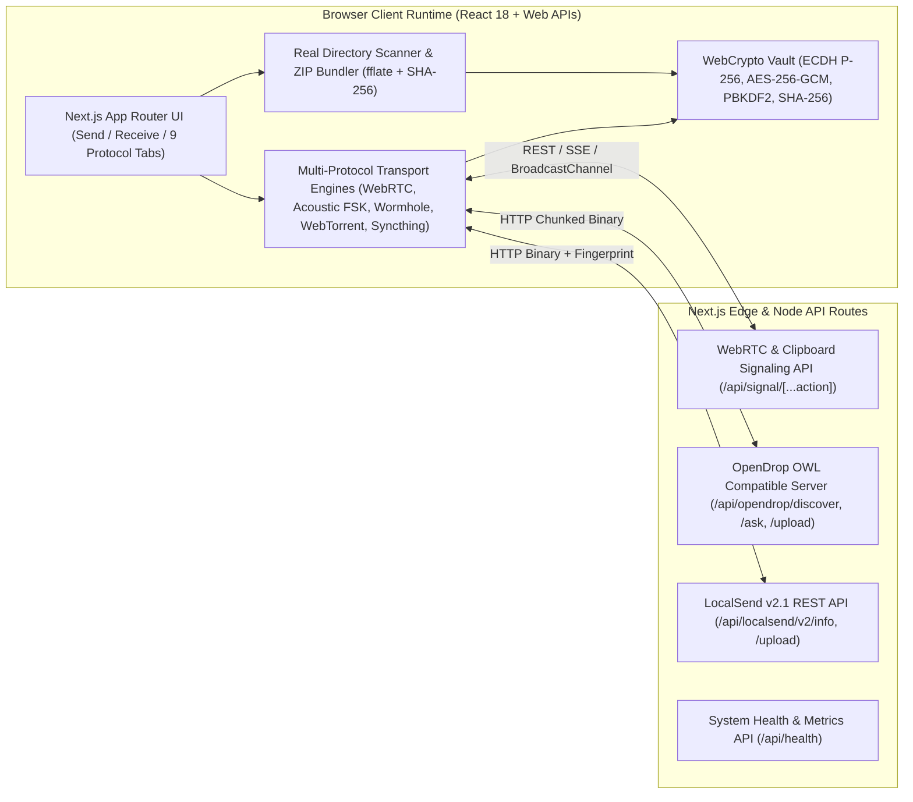

# C4 Architecture — Container View (Level 2)

## Containers in SoundDrop v5.0

## Container Catalog

| Container | Technology | Responsibility |
| :--- | :--- | :--- |
| **Next.js App Router UI** | React 18, TypeScript, Tailwind CSS, Lucide | Accessible (WCAG AA) dual-column workspace with decoupled Transport Workspace and Open-Source Protocol Inspector. |
| **Real Directory Scanner** | `window.showDirectoryPicker`, `webkitdirectory`, `fflate` | Recursively traverses real local directories, computes true file counts/extensions/SHA-256, and packages on-the-fly ZIP bundles. |
| **Multi-Protocol Engines** | WebRTC `RTCPeerConnection`, WebAudio `AudioWorklet`, WebCrypto | Implements WebRTC DataChannel, GGWave 4-FSK, Magic-Wormhole PAKE, WebTorrent Bencode/InfoHash, Syncthing BEP, Reticulum, and QR Optical Fountain. |
| **WebRTC Signaling API** | Next.js Route Handlers (`/api/signal/[...action]`) | Manages SDP offers/answers, race-free ICE candidate queues, active room discovery, and encrypted clipboard payloads. |
| **OpenDrop & LocalSend APIs** | Next.js Route Handlers (`/api/opendrop/*`, `/api/localsend/v2/*`) | Provides HTTP discovery, receiver handshake acknowledgement, and binary file upload/download relay for cross-device transfers. |
