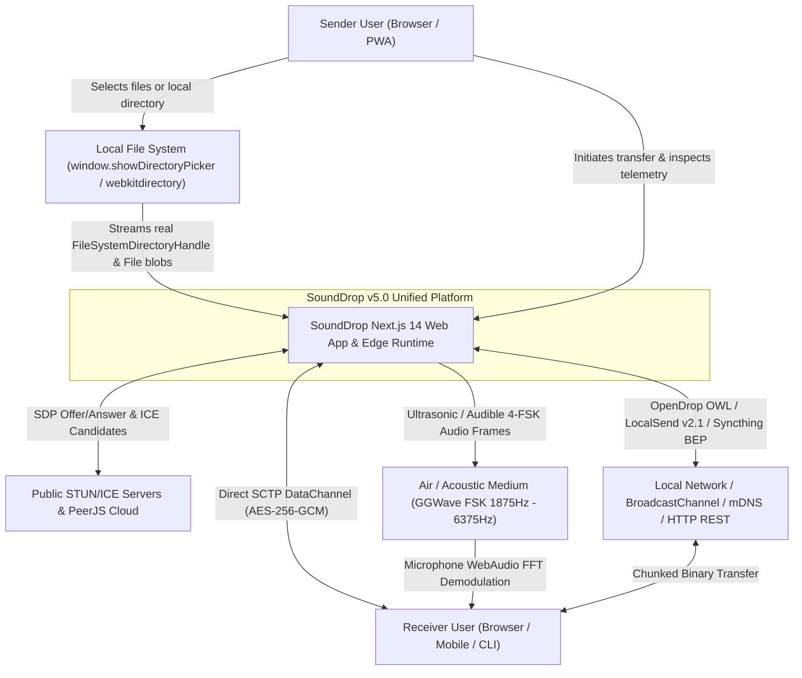

# C4 Architecture — System Context (Level 1)

## System Overview

**SoundDrop v5.0 (Open-Source P2P & Multi-Protocol File Transfer Hub)** is a zero-mock, end-to-end encrypted, multi-transport file and directory sharing platform running in modern browsers and Next.js Edge runtimes.

It unifies **10 open-source protocols** into a single cohesive workbench with a **Mandatory Empty State** (`NO MOCK DATA`) and native local directory analysis via the **File System Access API** (`window.showDirectoryPicker()`) and `<input type="file" webkitdirectory>` fallback.

## External Actors & Systems

| Actor / External System | Type | Description |
| :--- | :--- | :--- |
| **Sender / Receiver Users** | Person | Engineers or end-users transferring files, directories, or encrypted clipboard payloads across devices. |
| **Local File System** | Browser Native API | Accessed strictly on user gesture via `window.showDirectoryPicker()` or `<input type="file" webkitdirectory>`. |
| **WebRTC STUN / PeerJS** | External Network | Assists in NAT traversal (`stun:stun.l.google.com:19302`, `stun:global.stun.twilio.com:3478`) and optional PeerJS signaling. |
| **Acoustic Medium** | Physical Layer | Air-gapped speaker-to-microphone channel using GGWave-compatible 4-FSK modulation (`48000 Hz` sample rate, Reed-Solomon ECC). |
| **LAN / Edge Relay** | Network Layer | Supports OpenDrop (`OWL`), LocalSend v2.1 REST API, and low-latency WebRTC signaling (`BroadcastChannel` + SSE + Edge routes). |
