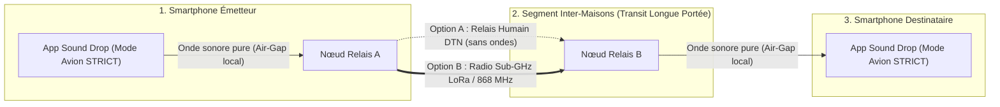

# ARCHITECTURE NATIVE & DESIGN SYSTEM SOUNDDROP

> **Statut : Spécification Technique & Architecture de Production**  
> Ce document définit l'architecture système native (Rust, Slint, Audio I/O, Cryptographie et Relais Multi-Sauts) de Sound Drop v2.

---

## 1. Principes Fondamentaux du Cœur Natif
1. **Zéro allocation sur le thread audio** : capture et restitution sans `malloc` ni verrous bloquants via ring-buffers sans verrou (`rtrb`).
2. **Interface native GPU** : moteur graphique Slint avec accélération matérielle (FemtoVG / OpenGL / Wayland / X11).
3. **Mascotte vectorielle réactive** : oscillateur physique harmonique du 2nd ordre modélisant les micro-interactions ($m\ddot{x} + c\dot{x} + kx = F(t)$).
4. **Physique des bulles** : intégration du moteur de collisions Rapier2D à 60 FPS pour la dynamique des pairs.
5. **Couche DSP & Modem** :
   - *Phase 1* : `ggwave` (C++ via bindings FFI) pour émission/réception immédiate et robuste.
   - *Phase 2* : MFSK 16 tons avec démodulation Goertzel native 48 kHz / 44,1 kHz.
   - Preamble chirp linéaire (1,5 kHz $\to$ 5,5 kHz) avec corrélation croisée FFT pour synchronisation et absorption de la dérive d'horloge.
6. **Vérification de proximité** : Short Authentication String (SAS) à 6 chiffres avec protocole Commit-Reveal sur clés éphémères X25519 / HKDF-SHA256.

---

## 2. Diode Matérielle vs Réception Seule Logicielle
- **Réception Seule Logicielle** : l'application n'ouvre aucun flux audio de sortie (`cpal` en mode flux de capture exclusif).
- **Diode Matérielle** : câble jack/adaptateur physique sans canal haut-parleur.
- **Note de sécurité** : le mode diode matérielle n'autorisant aucune émission acoustique en retour, il est incompatible avec le protocole interactif SAS (qui nécessite un échange bidirectionnel). Il s'appuie donc sur un secret partagé pré-établi (phrase de passe + Argon2id).

---

## 3. Relais Multi-Sauts & Nœuds Passerelles (Store-and-Forward)

Pour surmonter l'atténuation physique des ondes sonores (murs en béton, vent, distance > 2 mètres) sans sacrifier le principe fondamental de l'Air-Gap sur le terminal de l'utilisateur, Sound Drop met en œuvre une architecture de **relais multi-sauts hétérogène**.

### 3.1 Séparation des Couches & Principe d'Indépendance
* **Couche Ingress / Egress Utilisateur** : Exclusivement acoustique (ou optique). Le smartphone de l'utilisateur final reste en **mode avion strict** (antennes éteintes). Il ne communique qu'avec son haut-parleur et son microphone.
* **Couche Transit Inter-Nœuds (Mule de Données / Pont Radio)** :
  1. *Relais Humain (DTN - Delay Tolerant Network)* : Le nœud intermédiaire stocke les fragments chiffrés et les transporte physiquement avant de les re-siffler au destinataire.
  2. *Passerelle Radio Sub-GHz (LoRa / Meshtastic 433/868 MHz)* : Un nœud passerelle dédié sur le toit ou près de la fenêtre propulse les trames sur plusieurs kilomètres à travers les obstacles urbains.

### 3.2 Format de Trame Relais (`RelayFrameHeader`)
Chaque trame relayée étend le protocole binaire standard avec les métadonnées suivantes (en-tête de 6 octets) :
- `ttl` (1 octet) : Nombre de sauts restants (Time-To-Live, par défaut 3 à 5). Décrémenté à chaque relais ; le paquet est détruit si `ttl == 0`.
- `hop_count` (1 octet) : Nombre de sauts déjà franchis.
- `recipient_hash` (4 octets) : Empreinte tronquée $\text{SHA-256}(pub_{\text{destinataire}})[0..4]$. Permet au nœud relais de savoir si un pair croisé est le destinataire légitime sans connaître son identité réelle.
- `flags` (1 octet) : `0x01 = REQUIRE_ACK`, `0x02 = HIGH_PRIORITY`, `0x04 = ENCRYPTED_PAYLOAD`.

### 3.3 Chiffrement Opaque de Bout en Bout
Le corps de la charge utile (`payload`) est chiffré de bout en bout avec la clé publique éphémère du destinataire final (`X25519` + `ChaCha20-Poly1305`). 
**Aucun nœud relais intermédiaire ne dispose de la clé de déchiffrement** : ils transportent des blocs de données opaques sans jamais pouvoir en observer ou en modifier le contenu (toute modification corrompt le tag Poly1305 et entraîne le rejet de la trame).

### 3.4 File d'Attente Store-and-Forward
Le moteur de relais implémente une file persistante avec :
- Déduplication par empreinte de session (évite les tempêtes de retransmission en boucle).
- Expiration temporelle automatique des trames orphelines.
- Réémission prioritaire avec accusé de réception par saut (*Hop-by-Hop ARQ*).
