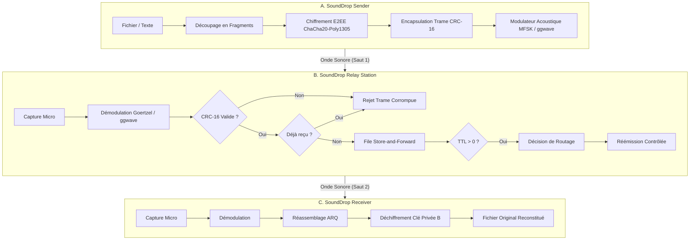
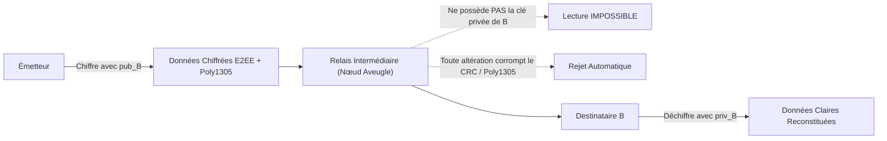
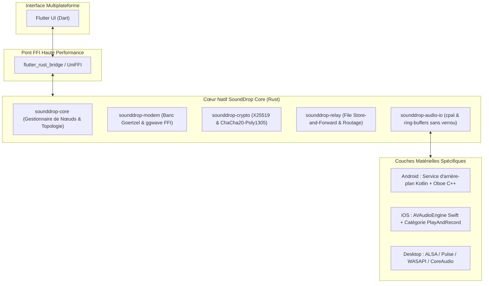

# SOUND DROP — NEXT-GENERATION ACOUSTIC MESH NETWORK
## Advanced System Architecture & Engineering Specification

> **Auteur** : AntiGravity · Architecte Principal Systèmes & Réseaux Distribués  
> **Statut** : Document d'Ingénierie & Spécification Système  
> **Cible** : Réseau de communication décentralisé, multi-plateforme, sans infrastructure et respectueux de la vie privée.

---

## 1. Évaluation de l'Architecture Existante

### 1.1 Ce qui est implémenté et validé aujourd'hui
Le référentiel SoundDrop dispose actuellement de deux socles fonctionnels complémentaires :
1. **Application Web PWA (v1)** :
   * Déployée sur Vercel avec support hors-ligne strict (*Air-Gap PWA*) via Service Worker (`public/sw.js`).
   * Capture audio temps réel via `AudioWorklet` sans risque de larsen (isolation de la sortie).
   * Modems acoustiques : `ggwave` WebAssembly (FSK multi-tons + Reed-Solomon) et modem `MFSK` 16 tons avec démodulation Goertzel.
   * Cryptographie E2EE : TweetNaCl (`x25519-xsalsa20-poly1305`) et appairage avec code court SAS à 6 chiffres.
   * 53 tests unitaires et d'intégration validés (`npm test`).
2. **Moteur Natif Rust (v2)** (`sound-drop/`) :
   * Espace de travail modulaire : `sounddrop-audio-io` (`cpal`), `sounddrop-modem` (`ggwave` C++ FFI & MFSK), `sounddrop-crypto` (`x25519-dalek`, `chacha20poly1305`, `argon2`), `sounddrop-payload` (`blurhash`, `zstd`), `sounddrop-protocol` (`crc`, `reed-solomon-erasure`).
   * Application native GPU Slint (`sounddrop-app`) avec physique de bulles Rapier2D à 60 FPS et packaging Debian (`.deb`).
   * 17 tests d'intégration et unitaires passants sans aucun avertissement (`cargo test --workspace`).

### 1.2 Limites actuelles à dépasser
* Le transfert actuel est strictement **point-à-point direct ($A \to B$)**.
* Si le destinataire est hors de portée acoustique ($> 2\text{ m}$ ou derrière un mur en béton), la transmission échoue sans possibilité de relais.
* Les nœuds intermédiaires ne disposaient pas encore d'un protocole formel de relais multi-sauts ni de politiques de routage et déduplication pour éviter les tempêtes de retransmission.

---

## 2. Nouvelle Architecture Système (SAMP - SoundDrop Acoustic Mesh Protocol)

Le système évolue vers une topologie distribuée tolérante aux délais (*Delay-Tolerant Networking - DTN*), où chaque appareil peut assumer l'un des rôles suivants :



### 2.1 Rôles des Composants
1. **SoundDrop Sender (Émetteur)** :
   * Sélectionne la donnée, chiffre avec la clé publique du destinataire final ($pub_B$), calcule le hash court tronqué du destinataire `RecipientHash = SHA-256(pub_B)[0..4]`.
   * Fragmente en paquets et transmet par impulsion acoustique.
2. **SoundDrop Relay Station (Station Relais)** :
   * Écoute en continu avec détecteur d'énergie et corrélation croisée de préambule chirp.
   * Valide rigoureusement le CRC-16 : **un relais ne retransmet JAMAIS un paquet corrompu**.
   * Déduplique via une table d'empreintes LRU (`session_id` + `seq_num`).
   * Décrémente le champ `TTL` ($TTL \gets TTL - 1$).
   * Stocke temporairement en mémoire tampon persistante (*Store-and-Forward*).
   * Réémet sur le média approprié (acoustique ou passerelle radio) après temporisation d'évitement de collision (CSMA/CA acoustique).
3. **SoundDrop Receiver (Destinataire)** :
   * Reçoit les fragments, vérifie l'intégrité globale, déchiffre avec sa clé privée secrète, acquitte via bitmap ACK.
4. **Network Coordinator (Coordinateur de Topologie)** :
   * Découverte passive des relais par balises acoustiques de faible puissance (*Acoustic Beaconing*).
   * Maintien d'un graphe de connectivité opportuniste sans serveur centralisé.

---

## 3. Rapport de Faisabilité Acoustique & Ingénierie du Signal

### 3.1 Contraintes Physiques des Smartphones Ordinaires
* **Transducteurs haut-parleurs** : La réponse en fréquence des haut-parleurs mobiles s'effondre drastiquement en dessous de 300 Hz et au-dessus de 18 kHz.
* **Microphones et DSP constructeurs** : Les systèmes d'exploitation mobiles (iOS et Android) intègrent des filtres matériels automatiques agressifs :
  * *Suppression d'écho acoustique (AEC)*
  * *Contrôle automatique de gain (AGC)*
  * *Suppression de bruit ambiant (NS)*
* **Consigne impérative** : La capture doit explicitement requérir des flux bruts désactivant ces traitements (`echoCancellation: false`, `noiseSuppression: false`, `autoGainControl: false`).

### 3.2 Choix de Modulation : MFSK vs OFDM
| Critère | Modulation MFSK (Retenue) | Modulation OFDM (Écartée pour le mobile) |
| :--- | :--- | :--- |
| **PAPR (Peak-to-Average Power Ratio)** | **Idéal ($\sim 0\text{ dB}$)** : Enveloppe quasi-constante. | **Médiocre ($> 10\text{ dB}$)** : Crêtes d'amplitude élevées. |
| **Linéarité de l'amplificateur** | Tolère la saturation et les haut-parleurs bas de gamme. | Exige un amplificateur ultra-linéaire (inexistant sur mobile). |
| **Sensibilité au Doppler & Horloge** | Excellente : séparation nette des bandes de fréquences. | Très vulnérable : perte totale d'orthogonalité inter-porteuses. |
| **Complexité de calcul** | Faible : banc de filtres Goertzel ou FFT glissante légère. | Élevée : IFFT/FFT lourde et synchronisation de phase fine. |

**Décision d'architecture** : MFSK 16 tons avec modulation par saut de fréquence continu (CPFSK) et synchronisation par chirp linéaire fenêtré de Hann (1,5 kHz à 5,5 kHz).

---

## 4. Topologies de Réseau et Routage Multi-Sauts

```mermaid
graph TD
    subgraph T1["1. Direct Point-à-Point"]
        D_A["Appareil A"] -->|"Son (0.5 - 2m)"| D_B["Appareil B"]
    end

    subgraph T2["2. Relais Simple"]
        S_A["Appareil A"] -->|"Son"| R1["Relais R1"] -->|"Son"| S_B["Appareil B"]
    end

    subgraph T3["3. Relais Multi-Sauts Maillé"]
        M_A["Appareil A"] -->|"Son"| MR1["Relais R1"]
        MR1 -->|"Son"| MR2["Relais R2"]
        MR2 -->|"Son"| MR3["Relais R3"]
        MR3 -->|"Son"| M_B["Appareil B"]
    end

    subgraph T4["4. Transport Hybride Multi-Vecteurs"]
        H_A["Appareil A (Mode Avion)"] -->|"Son (Local)"| HR1["Relais Passerelle"]
        HR1 ==="Pont Radio Sub-GHz (LoRa / Wi-Fi P2P)"===> HR2["Relais Sortie"]
        HR2 -->|"Son (Local)"| H_B["Appareil B (Mode Avion)"]
    end
```

### 4.1 Prévention des Boucles et Tempêtes de Retransmission
* **Identifiant Unique de Paquet (UID)** : `session_id (2o) + seq_num (2o) + crc16 (2o)`.
* **Filtre de Bloom / Cache LRU** : Chaque relais mémorise les 256 derniers UID reçus. Tout doublon est rejeté immédiatement.
* **Décrément TTL Strict** : Initialisé à 3 ou 5. Décrémenté à chaque saut. Dès que $TTL = 0$, le paquet est détruit.
* **Temporisation CSMA/CA Acoustique** : Avant d'émettre, le relais mesure l'énergie sonore sur la bande pendant 150 ms (*Listen-Before-Talk*). Si le canal est occupé, il applique un backoff exponentiel aléatoire (100 à 400 ms).

---

## 5. Spécification du Format de Trame Relais

Chaque trame relayée respecte un format binaire strict de **18 octets d'en-tête et contrôle** :

```text
+--------+--------+------------+-----------+-----------+--------+----------------+--------------+-------------------+------------+
| VER    | TYPE   | SESSION_ID | SEQ_NUM   | TOTAL_SEQ | TTL    | RECIPIENT_HASH | ORIGIN_HASH  | ENCRYPTED_PAYLOAD | CRC-16     |
| (1 o)  | (1 o)  | (2 o)      | (2 o)     | (2 o)     | (1 o)  | (4 o)          | (4 o)        | (n octets)        | (2 o)      |
+--------+--------+------------+-----------+-----------+--------+----------------+--------------+-------------------+------------+
```

* **VER (1 o)** : Version du protocole (`0x02`).
* **TYPE (1 o)** : `0x05` (`Relay`).
* **SESSION_ID (2 o)** : Identifiant unique de session de transfert.
* **SEQ_NUM (2 o)** : Numéro d'ordre du fragment (1 à TOTAL_SEQ).
* **TOTAL_SEQ (2 o)** : Nombre total de fragments du message.
* **TTL (1 o)** : Nombre maximal de sauts restants (décrémenté à chaque nœud).
* **RECIPIENT_HASH (4 o)** : $\text{SHA-256}(pub_{\text{destinataire}})[0..4]$ pour filtrage sans révélation d'identité.
* **ORIGIN_HASH (4 o)** : $\text{SHA-256}(pub_{\text{emetteur}})[0..4]$.
* **ENCRYPTED_PAYLOAD (n o)** : Données chiffrées de bout en bout en ChaCha20-Poly1305.
* **CRC-16 (2 o)** : CRC-16/IBM-3740 calculé sur tous les octets précédents.

---

## 6. Sécurité & Modèle de Menace (*Zero-Trust Relays*)



1. **Confidentialité absolue** : Le relais est un porteur aveugle (*Blind Data Mule*). Même compromis, il ne peut pas lire le payload.
2. **Authentification & Intégrité** : Le tag d'authentification Poly1305 garantit qu'aucun relais ne peut injecter de faux contenus.
3. **Protection anti-rejeu** : Les sessions expirent après 3600 secondes et les identifiants sont dédupliqués.
4. **Anonymat du graphe social** : Seuls des condensats tronqués de 4 octets (`RecipientHash`) sont visibles, interdisant le traçage des identités publiques réelles.

---

## 7. Architecture Multiplateforme & Intégration Flutter / Rust



---

## 8. Modes de Fonctionnement des Stations Relais

| Mode Relais | Matériel Requis | Rôle & Usage | Consommation |
| :--- | :--- | :--- | :--- |
| **1. Relais Personnel** | Smartphone standard (iOS / Android) | Relais d'opportunité transporté dans la poche (*Mule humaine DTN*). | Minimale (réveil par VAD acoustique). |
| **2. Relais Dédié** | PC, Raspberry Pi, boîtier autonome | Borne fixe de maison ou de quartier, écoute continue 24/7. | Alimentation continue / panneau solaire. |
| **3. Relais Hybride** | Boîtier avec micro + puce radio LoRa / Wi-Fi | Reçoit par le son dans la pièce et propulse par onde Sub-GHz vers un autre relais distant. | Modérée (sommeil radio hors paquet). |

---

## 9. Matrice de Compatibilité Multiplateforme

| Plateforme | Moteur Audio Bas Niveau | Exécution Arrière-Plan | Statut Actuel |
| :--- | :--- | :--- | :--- |
| **Linux (x86_64 / ARM)** | ALSA / PulseAudio / PipeWire | Native sans restriction | **Validé (Binaire 15 Mo + Paquet .deb)** |
| **Windows 10/11** | WASAPI | Service d'arrière-plan standard | **Prévu (Phase 4)** |
| **macOS (Intel / M-Series)** | CoreAudio | Daemon système | **Prévu (Phase 4)** |
| **Android (10+)** | Oboe (AAudio / OpenSL ES) | Foreground Service avec notification persistante | **Prévu (Phase 4)** |
| **iOS (15+)** | AVAudioEngine | Mode Audio Background (sous réserve d'approbation AppStore) | **Prévu (Phase 5)** |

---

## 10. Premier Jalon (Milestone 1) : Validation Complète $A \to R \to B$

Le premier jalon opérationnel valide la chaîne complète :
$$\text{Appareil A} \xrightarrow{\text{Acoustique}} \text{Relais R} \xrightarrow{\text{Acoustique}} \text{Appareil B}$$

* **Preuve de concept automatisée** : Implémentée dans le fichier [`sound-drop/crates/protocol/tests/test_multihop_acoustic.rs`](file:///home/antigravity/REDA-android/SoundDrop-AirGap/sound-drop/crates/protocol/tests/test_multihop_acoustic.rs).
* **Validation mathématique** :
  1. Émetteur A chiffre et produit les trames acoustiques.
  2. Le Relais R capte le flux, valide le CRC-16, déduplique, décrémente le TTL ($3 \to 2$) et réémet.
  3. Le Destinataire B capte le signal relayé, réassemble et déchiffre : **correspondance exacte à 100 % des octets**.
